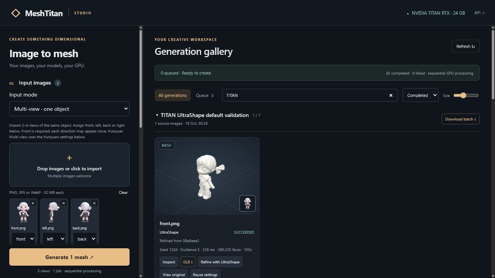

# Project checkpoint — 18 October 2026

The local Windows studio is operational. The operator reported that the multi-view and refinement additions
work well. This checkpoint records the implementation, setup instructions and targeted verification performed
on the TITAN RTX. Full MT-004 hardware qualification remains open in [issue #6](https://github.com/techrote/meshtitan/issues/6).

## Working features

- Local browser studio at `http://127.0.0.1:8088/`, served by the Python broker with bundled Three.js assets.
- Independent image batches, sequential execution, named groups, thumbnail grids, filtering, cancellation,
  saved settings/presets, individual downloads and batch ZIP downloads.
- Interactive mesh preview with orbit/zoom, wireframe, rotation, colour and up-axis controls.
- Hunyuan3D 2.1 single-image shape generation and TripoSR geometry generation.
- Hunyuan3D-2mv generation from 2–4 labelled canonical views of one object, including front.
- Hunyuan seed variations and guidance-strength sweeps, with fixed seeds within each guidance comparison.
- Custom extraction resolution 16–1024, requiring explicit experimental opt-in outside 64–512.
- TripoSR density threshold, foreground ratio, background fill and query chunk controls.
- UltraShape refinement of a completed mesh, with separate settings, original-mesh comparison and durable
  parent-job/reference-image links. Multi-view source images can be reused together.
- `windows.bat setup|run|doctor|help`, plus setup/run shortcuts and a backwards-compatible PowerShell bootstrap.



## Runtime boundaries

The broker remains free of PyTorch/CUDA Python dependencies. Each backend has an isolated environment and runs
in a subprocess with exactly one configured GPU UUID exposed. The default hardware contract remains TITAN RTX,
SM75 and at least 22 GiB. Jobs execute one at a time. Paint/PBR and texture baking remain outside the core runtime.

The two original upstream pins are unchanged. Multi-view and UltraShape sources and primary weights are pinned
separately; see [Windows setup](WINDOWS.md) and [backend contracts](BACKENDS.md). UltraShape uses a reviewed,
per-job compatibility copy for FP16/PyTorch attention, CPU voxel preparation and CPU marching cubes. Its vendor
checkout is preserved. Input hashes, source-mesh hashes, effective settings, compatibility hashes, logs and GPU
telemetry remain durable alongside job records.

## Verification at this checkpoint

Software checks passed on Windows with Python 3.10:

```text
python -m compileall -q src
ruff check src tests
pytest -q                         # 33 passed
node --test tests/test_batch_plan.mjs  # 5 passed
node --check src/meshtitan/web/app.js
git diff --check
```

The package wheel includes the web assets and new runner/compatibility modules. The Windows extension setup
completed on the existing installation, its active-server guard was checked, `windows.bat run` started the
service, and `doctor` found the configured TITAN and all four pinned backend checkouts. A fresh Windows machine
still needs the prerequisites documented in [WINDOWS.md](WINDOWS.md); that is a different installation scenario.

Browser checks covered multi-view upload/assignment/submission, refinement submission, previews, thumbnails,
original-mesh comparison and source-view reuse. Artifact downloads parsed as nonempty meshes with finite
coordinates. The original mesh hash remained unchanged after refinement. The variable-length attention adapter
was compared with an FP32 reference on the TITAN, with maximum observed absolute error `0.0009765625`.

Target-machine observations for the upstream multi-view example object:

| Operation | Settings | Faces | Wall time | PyTorch peak allocation |
| --- | --- | ---: | ---: | ---: |
| Hunyuan3D-2mv | front/left/back, 30 steps, guidance 5, seed 1234, resolution 256, CPU offload | 281,900 | 76.813 s | 2,810.49 MiB |
| UltraShape | preceding mesh + front image, 30 steps, guidance 5, seed 1234, 8192 tokens, resolution 256, CPU offload | 380,235 | 104.875 s | 7,920.34 MiB |

These are individual local observations, including model startup and processing, not comparative benchmarks
or a performance guarantee. PyTorch peak allocation is not total GPU usage. Both meshes had consistent winding
but were not watertight; print-ready/manifold geometry is not certified. Higher resolutions/token counts and
the complete repeated frozen-corpus acceptance procedure remain unqualified. GitHub-hosted CI supplies
software evidence only.

A portable summary of these observations is retained in [evidence/titan-extensions.json](evidence/titan-extensions.json).
Complete job directories and generated meshes remain local under ignored `var/`; historical failed/cancelled
jobs are preserved rather than removed from the gallery.

## What GitHub contains

Source, tests, setup/run scripts, pinned configuration examples, documentation, a UI screenshot and the selected
evidence summary. Local environments, downloaded model repositories/weights, generated meshes, caches and
`meshtitan.toml` are intentionally excluded. Reconstruct the application with [the Windows instructions](WINDOWS.md)
and set the local GPU selector as appropriate.
